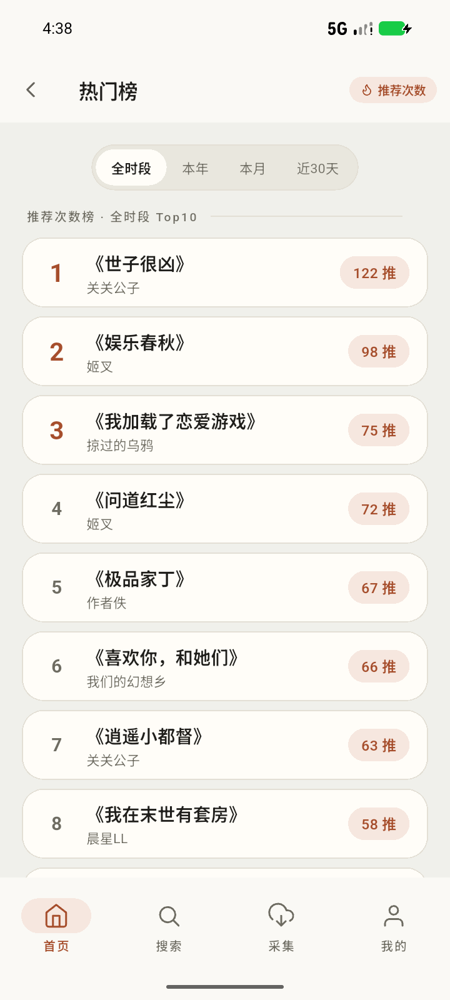
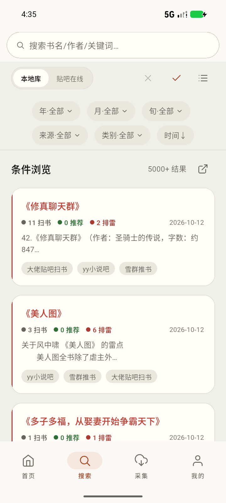
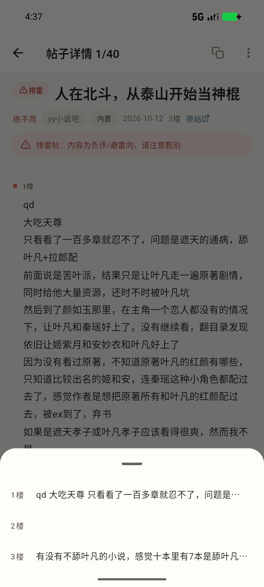
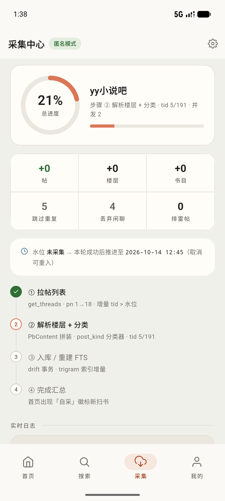
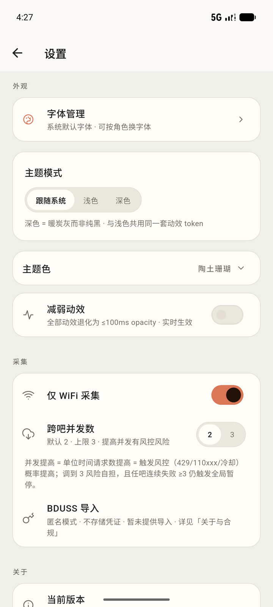
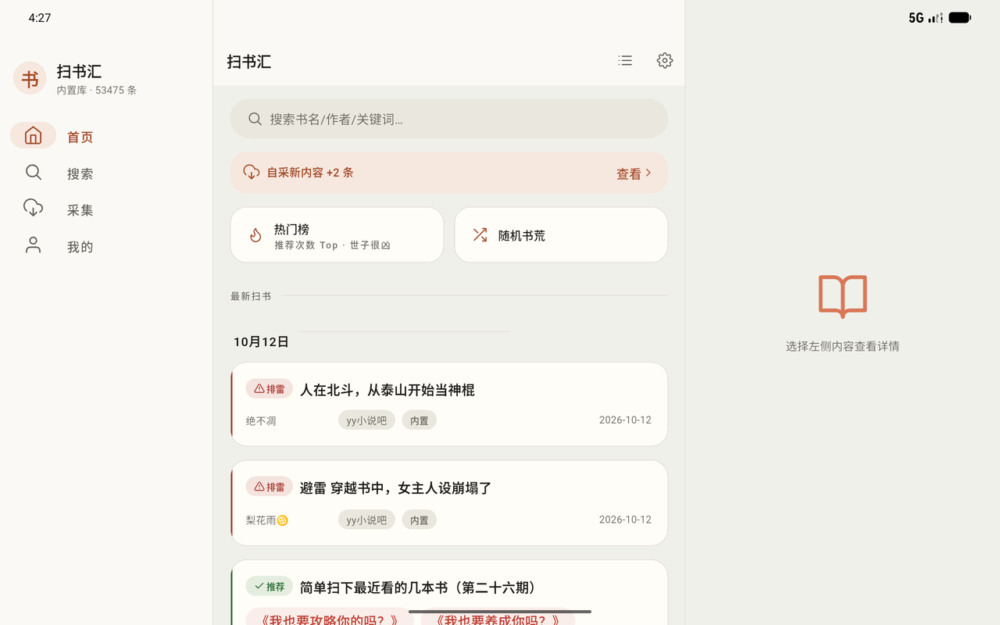
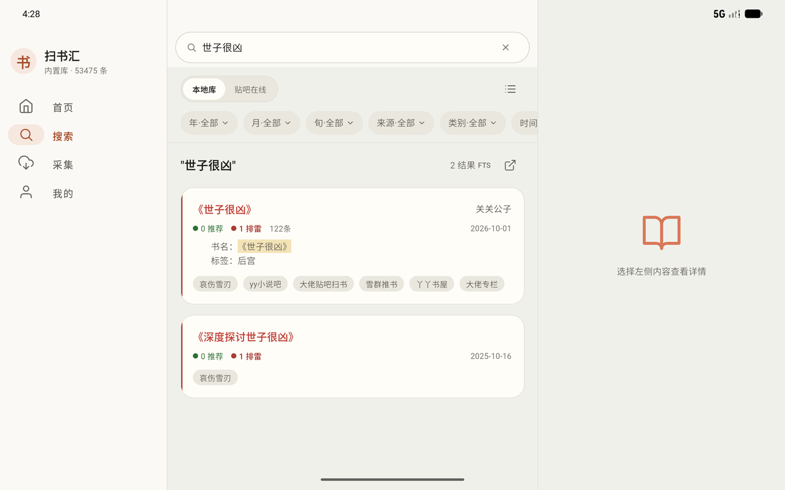

<h1 align="center">扫书汇</h1>

<p align="center">
  <b>BookSift</b>
</p>

<p align="center">
  <nobr>
    
    
    
    
    
  </nobr>
</p>

> 贴吧「扫书帖」离线书单浏览器：内置整理好的本地书库，支持全文检索、推荐排雷识别和按需增量采集。

## 核心功能

- **离线浏览与检索**：按书名、作者、正文、年份、来源和类别搜索，支持书级聚合、帖子详情、热门榜和随机书荒。
- **阅读与整理**：保留帖子富文本、图片和楼层目录；支持书签、收藏、搜索历史、Markdown/TXT 导出与原帖溯源。
- **推荐与排雷**：用 v3 分类器识别推荐、排雷和求书内容，统一展示在卡片、筛选、聚合页和帖子详情中。
- **增量更新**：内置种子包开箱即用；采集中心可按吧增量采集新帖，断点续采并自动去重。
- **本地优先**：不依赖自建服务端，数据和个人记录保存在设备本地；默认匿名使用，BDUSS 仅作为可选的本地凭证。

## 界面预览

### 首页与榜单

<p align="center">
  
  
</p>

### 搜索与阅读

<p align="center">
  
  
  
</p>

### 采集与设置

<p align="center">
  
  
</p>

### 宽屏布局

<p align="center">
  
  
</p>

## 安装与使用

### 直接下载

在 [Releases 页面](https://github.com/LinYuanovo/BookSift/releases) 下载对应平台的安装包：

| 平台 | 文件 | 说明 |
| --- | --- | --- |
| Android | [`BookSift-android-v1.0.2.apk`](https://github.com/LinYuanovo/BookSift/releases/download/v1.0.2/BookSift-android-v1.0.2.apk) | Android 7.0+，允许安装未知应用 |
| iOS | [`BookSift-ios-v1.0.2.ipa`](https://github.com/LinYuanovo/BookSift/releases/download/v1.0.2/BookSift-ios-v1.0.2.ipa) | 未签名包需使用自己的证书签名 |
| Windows | [`BookSift-windows-x64-v1.0.2.zip`](https://github.com/LinYuanovo/BookSift/releases/download/v1.0.2/BookSift-windows-x64-v1.0.2.zip) | Windows 10/11，完整解压后运行 `booksift.exe` |
| macOS | [`BookSift-macos-universal-v1.0.2.zip`](https://github.com/LinYuanovo/BookSift/releases/download/v1.0.2/BookSift-macos-universal-v1.0.2.zip) | 包含 arm64 与 x86_64，未签名包可能被 Gatekeeper 拦截 |
| Linux | [`BookSift-linux-x64-v1.0.2.tar.gz`](https://github.com/LinYuanovo/BookSift/releases/download/v1.0.2/BookSift-linux-x64-v1.0.2.tar.gz) | Ubuntu 22.04+，需 GTK3 / libsecret |

发布页不一定同时提供所有平台的包；每个文件旁都有同名 `.sha256`，建议用 `certutil -hashfile <文件> SHA256` 校验。

应用内更新详见[在线更新契约](website/guide/update.md)。

Android 安装后首次启动会询问是否建立全文索引，然后校验并导入内置种子包，期间无需联网。安装和首启不会覆盖收藏、书签、搜索历史或采集数据。

### 使用教程

- [在线文档站](https://linyuanovo.github.io/BookSift/)
- [常见问题](https://linyuanovo.github.io/BookSift/faq)
- [采集中心](https://linyuanovo.github.io/BookSift/guide/collect)
- [数据来源与合规](https://linyuanovo.github.io/BookSift/guide/data)

底部四个入口分别是：首页、搜索、采集和我的。完整的页面说明、数据位置、BDUSS 和采集限制见文档站。

## 开发者内容

<details>
<summary>从源码构建</summary>

需要 Flutter SDK ≥ 3.41.9、Dart SDK ≥ 3.11.5。Windows 开发需要 Windows 10/11；Linux 桌面构建需要 Ubuntu 22.04+ 及 GTK3 / libsecret。

```powershell
git clone https://github.com/LinYuanovo/BookSift.git
cd BookSift\app

flutter pub get
flutter run -d windows            # 开发调试
flutter build apk --release       # → build/app/outputs/flutter-apk/app-release.apk
flutter build windows --release   # → build/windows/x64/runner/Release/
flutter build linux --release     # → build/linux/x64/release/bundle/
```

drift 生成代码（`*.g.dart`）已入库，clone 后无需跑 `build_runner`。

Android 发布包可让脚本一键走完「preflight → 构建 → apksigner 验签 → 权限闸门 → 组装 `dist_release/`」：

```powershell
pwsh tools/make_release.ps1        # 版本号取自 app/pubspec.yaml；-Publish 会执行 gh release create
```

Linux 桌面发布包（Ubuntu）用 bash 脚本一键走完「preflight → 构建 → 产物闸门 → 组装」，产物落 `dist_release/`：

```bash
tools/make_release_linux.sh        # 版本号取自 app/pubspec.yaml；产物 BookSift-linux-x64-v<版本>.tar.gz
```

Linux 构建环境（Ubuntu 22.04+/24.04 实测）：

```bash
sudo apt-get install -y clang cmake ninja-build pkg-config lld binutils \
  libgtk-3-dev libsecret-1-dev liblzma-dev libstdc++-12-dev
# Flutter SDK 3.41.9：flutter_linux_3.41.9-stable.tar.xz 解包到 /opt/flutter 即可（无额外安装步骤）
```

`sqlite3` 的原生资产构建钩子会从 GitHub Releases 下载预编译 `libsqlite3.x64.linux.so`。无 GitHub 直连的机器需预先把该文件放到 `app/.dart_tool/hooks_runner/shared/sqlite3/build/download-b1772918/libsqlite3.so`。

测试**不要裸跑** `flutter test`，一律使用墙钟看门狗：

```powershell
pwsh tools/run_tests_safe.ps1
```

推送与 `app/pubspec.yaml` 版本一致的 tag 可触发 GitHub Actions 构建与发布：

```powershell
git tag v1.0.2
git push origin v1.0.2
```

</details>

<details>
<summary>Headless CLI / API</summary>

采集、分类、检索和入库逻辑都是纯 Dart，可在不启动 Flutter GUI 的情况下运行。完整规格见 [`app/HEADLESS.md`](app/HEADLESS.md)，用法见[文档站](https://linyuanovo.github.io/BookSift/development/headless)。

```powershell
pwsh tools/smoke_cli.ps1                    # 构建并验证真实 CLI bundle（墙钟看门狗）
cd app
& C:\flutter\bin\dart.bat build cli          # 一次编译，bundle 自带 sqlite3.dll
$exe = ".\build\cli\windows_x64\bundle\bin\booksift.exe"

& $exe doctor                                 # 环境自检（零网络）
& $exe --version                             # 输出 CLI 版本
& $exe --json --db <path> stats               # 结果 JSON→stdout，日志 JSONL→stderr
& $exe --db <path> query 诡秘之主 --limit 5
& $exe --json --db <path> facets --year 2026 --month 10
& $exe --json --db <path> hot --limit 10
& $exe --json --db <path> random --count 5
& $exe --json --db <path> timeline --limit 20
& $exe --json --db <path> rank --kind word --window year --limit 10
& $exe --json --db <path> show book 123
& $exe --json --db <path> show book 123 --filter recommend --sort time_desc --limit 50 --offset 0
& $exe --json --db <path> show post 456
& $exe --json --no-log-file logs --file .\logs\<run-id>.jsonl --level warn
& $exe classify --title "《某某》排雷" --floor "正文…"
& $exe --db <path> collect                    # 只出计划，零请求
```

| 要点 | 说明 |
| --- | --- |
| 子命令 | `doctor` / `stats` / `query` / `facets` / `hot` / `random` / `timeline` / `rank` / `show book|post` / `classify` / `logs` / `seed` / `collect` |
| 日志 | 每次运行落 `app/logs/<run_id>.jsonl`；`logs --run <id>` / `logs --file <path>` 可回放逐条事件；`--no-log-file` 可关 |
| `--json` | 成功结果或 `{"error":...}` 走 stdout、JSONL 诊断走 stderr，可直接管道给 `jq` |
| 退出码 | `0` 成功 / `1` 采集或运行失败 / `2` 参数错误 / `3` 网络闸门未放行或运行中切离 Wi-Fi |
| 网络 | 只有 `collect --net` 发真请求，须同时设置 `BOOKSIFT_NET=1`，并受 `--budget` 上限约束 |

```dart
import 'package:booksift/booksift.dart';   // 纯 Dart barrel，零 flutter 依赖

final AppDatabase db = HeadlessEnv.openDb('path/to/app.sqlite');
final BookQueryApi api = BookQueryApi(db);
final SearchOutcome hits = await api.search(const SearchFilter(query: '无限流'));
await db.close();
```

</details>

<details>
<summary>技术栈与项目结构</summary>

基于 [Flutter](https://flutter.dev)、[Dart](https://dart.dev)、[Riverpod](https://riverpod.dev)、[drift](https://drift.simonbinder.eu/) + sqlite3、[go_router](https://pub.dev/packages/go_router)、[dio](https://pub.dev/packages/dio)、[protobuf](https://pub.dev/packages/protobuf)、[flutter_svg](https://pub.dev/packages/flutter_svg) 和 [share_plus](https://pub.dev/packages/share_plus) 构建。

```
booksift/
├── app/                          # Flutter 工程（android / ios / macos / windows / linux）
│   ├── bin/booksift.dart         # headless CLI 入口
│   ├── lib/
│   │   ├── booksift.dart         # 纯 Dart 门面 barrel（不导出依赖 flutter 的库）
│   │   ├── headless/             # 脱 GUI 适配层：logs / env / query / collect / seed
│   │   ├── classify/             # v3 分类器（R1–R8 规则 + 书名词典锚点）
│   │   ├── collector/            # 采集编排、限速调度、protobuf 通道、入库管线
│   │   ├── data/                 # drift 数据库、查询、仓库、种子导入、存量维护
│   │   ├── features/             # 页面：home / search / content / collect / rank / export / share / profile
│   │   ├── core/                 # 字体、图标、更新检查、外链、窗口尺寸
│   │   └── theme/                # 设计令牌：Colors / Typography / Spacing / Radius / Motion
│   ├── assets/                   # 种子包 / SVG 图标 / 书名词典
│   ├── tool/                     # 开发用小工具
│   └── test/                     # 测试（TESTING.md：测试纪律与挂死根因）
├── tools/                        # 测试看门狗（run_tests_safe.ps1）与发布脚本
└── website/                      # VitePress 文档站（自动部署到 GitHub Pages）
```

</details>

<details>
<summary>文档站本地预览</summary>

```powershell
cd website
npm install
npm run docs:dev       # http://localhost:5173/BookSift/
npm run docs:build     # 产物 → .vitepress/dist
```

</details>

## 数据与许可证

- 内置数据来自贴吧公开扫书相关帖子，应用只做离线整理与检索；帖子内容版权归原作者和发帖人所有。
- 采集和在线搜索使用非公开的逆向接口，可能随时失效；请低频、按需使用并自行承担风控风险。
- 应用默认匿名，不上传本地数据；BDUSS 只存设备本地系统加密存储，不入库、不写日志、不上传。
- 本项目采用 [GNU Affero General Public License v3.0](https://www.gnu.org/licenses/agpl-3.0.html)。
- 贴吧接口的 protobuf 定义与协议行为参考 [aiotieba](https://github.com/lumina37/aiotieba)。
